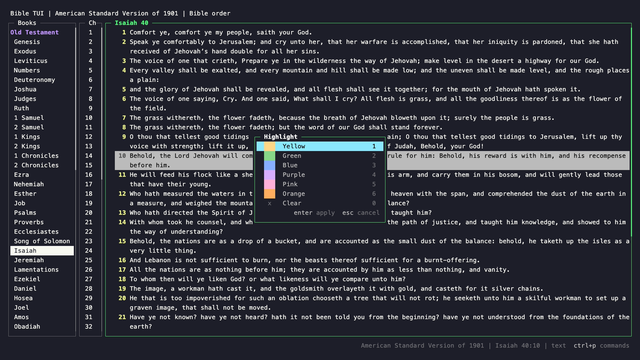
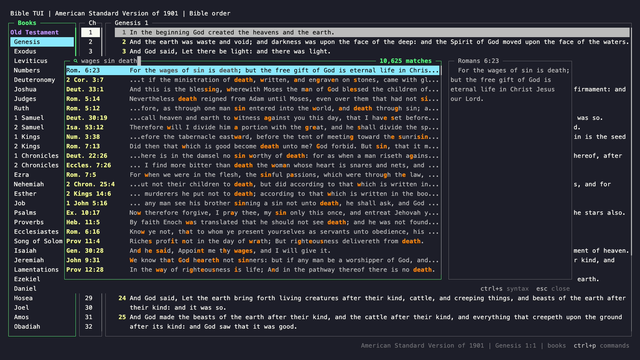
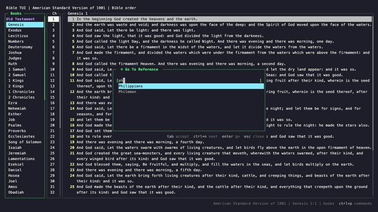
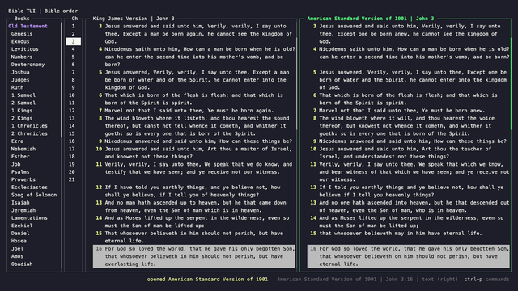

<h1 align="center">
  <picture>
    <source media="(prefers-color-scheme: dark)" srcset="https://raw.githubusercontent.com/codysechelski/bible-tui/main/docs/logo/bible-tui-logo-dark.png">
    
  </picture>
</h1>

<p align="center">
  <a href="https://github.com/codysechelski/bible-tui/releases"></a>
  <a href="https://github.com/codysechelski/bible-tui/actions/workflows/release.yml"></a>
  <a href="https://pypi.org/project/bible-tui/"></a>
  <a href="https://github.com/codysechelski/bible-tui/blob/main/pyproject.toml"></a>
  <a href="https://github.com/codysechelski/bible-tui/blob/main/pyproject.toml"></a>
</p>

A fast, dependency-free terminal Bible reader with Vim-style keys.


- **[Read and navigate](https://github.com/codysechelski/bible-tui/blob/main/docs/features/navigation.md)** with arrows or Vim keys,
  [jump to `John 3:16`](https://github.com/codysechelski/bible-tui/blob/main/docs/features/go-to-reference.md) with autocomplete, and use a Vim-style
  [`:` command line](https://github.com/codysechelski/bible-tui/blob/main/docs/features/command-line.md).
- **[Search](https://github.com/codysechelski/bible-tui/blob/main/docs/features/search.md)** within a chapter, or
  [fuzzy-find across the whole Bible](https://github.com/codysechelski/bible-tui/blob/main/docs/features/fuzzy-find.md) with a live preview.
- **[Compare two versions](https://github.com/codysechelski/bible-tui/blob/main/docs/features/split-view.md)** side by side, with verses lined up.
- **[Mark](https://github.com/codysechelski/bible-tui/blob/main/docs/features/marks.md) and [highlight](https://github.com/codysechelski/bible-tui/blob/main/docs/features/highlights.md)** verses in six colors. They're
  saved and show in every version.
- **[Bring any version you have the rights to](https://github.com/codysechelski/bible-tui/blob/main/docs/features/versions.md)**, in any language: each one is a SQLite file. The
  public-domain KJV and ASV are included (see [what about the NIV or ESV?](https://github.com/codysechelski/bible-tui#what-about-the-niv-or-esv)).

| | |
| --- | --- |
| [](https://github.com/codysechelski/bible-tui/blob/main/docs/features/highlights.md) | [](https://github.com/codysechelski/bible-tui/blob/main/docs/features/fuzzy-find.md) |
| [Highlight verses](https://github.com/codysechelski/bible-tui/blob/main/docs/features/highlights.md) in six colors | [Fuzzy-find](https://github.com/codysechelski/bible-tui/blob/main/docs/features/fuzzy-find.md) across the whole Bible |
| [](https://github.com/codysechelski/bible-tui/blob/main/docs/features/go-to-reference.md) | [](https://github.com/codysechelski/bible-tui/blob/main/docs/features/split-view.md) |
| [Go to a reference](https://github.com/codysechelski/bible-tui/blob/main/docs/features/go-to-reference.md) with autocomplete | [Compare two versions](https://github.com/codysechelski/bible-tui/blob/main/docs/features/split-view.md) side by side |

**[See all features →](https://github.com/codysechelski/bible-tui/blob/main/docs/features/index.md)** Each one has a short animation.

## Install

bible-tui runs on macOS and Linux. Install it with [Homebrew](https://brew.sh), which brings its own Python:

```sh
brew install codysechelski/tap/bible-tui
```

Or with [pipx](https://pipx.pypa.io), using Python 3.9 or newer:

```sh
pipx install bible-tui
```

Then run `bible-tui`. You can also run it from a clone with `./bible-tui`. `pip install bible-tui` works too, but
pipx keeps it in its own environment.

bible-tui checks for new releases once a day and tells you in the footer. Run `:update` to install the new
version and restart where you were. To turn the check off, set `"check_for_updates": false` (see
[update checks](https://github.com/codysechelski/bible-tui/blob/main/docs/configuration.md#update-checks)).

## Usage

```sh
bible-tui                         # open the default version
bible-tui asv                     # open a version by abbreviation
bible-tui ~/my.sqlite             # open a database file directly
bible-tui --bibles-dir ~/Bibles   # search an extra folder (repeatable)
bible-tui --list-versions
bible-tui --paths                 # show the config, state, and Bible folders in use
```

| Action | Keys |
| --- | --- |
| Move | arrows, or `h` `j` `k` `l` |
| Next / previous chapter | `]` / `[` |
| Go to a reference | `ctrl+g`, or `:John 3:16` |
| Search the chapter / the whole Bible | `/` / `ctrl+s` |
| Switch version | `t` |
| Split to compare versions | `ctrl+w v` |
| Mark / highlight a verse | `m` / `c` |
| Copy the verse | `yy` |
| All commands and keys | `ctrl+p` or `?` |
| Quit | `q` |

Every action also works without Vim keys. The full list is in [docs/keybindings.md](https://github.com/codysechelski/bible-tui/blob/main/docs/keybindings.md).\n\nCurious how far the Vim inspiration goes? Read the [Vim-inspired navigation philosophy](docs/vim-inspired-navigation.md).

## Adding versions

Each version is one SQLite file. Copy a database into `~/.config/bible-tui/bibles/` and it appears in the
version picker.

## What about the NIV or ESV?

bible-tui will only ever ship Bibles that are in the public domain or under an open licence that lets them be
shared. Most modern translations, including the NIV and ESV, are under copyright, so they can't be distributed
through this repo, and pull requests that add them can't be accepted.

You can still read any version you have the rights to use:

- **Convert a published Bible.** [bible-tui-bible-converter](https://github.com/codysechelski/bible-tui-bible-converter),
  a companion tool from the same author, turns USFM, USX, OSIS, and other formats into bible-tui databases.
  [docs/adding-bibles.md](https://github.com/codysechelski/bible-tui/blob/main/docs/adding-bibles.md) walks through it.
- **Make your own database.** bible-tui doesn't care where a database came from. It only has to match the
  [database schema](https://github.com/codysechelski/bible-tui/blob/main/docs/bible-databases.md#schema). Most coding agents can take Bible text from whatever
  source you have it in and write a SQLite file with this schema.

## Configuration

`config.json` lives in the app home: `~/.bible-tui` if that folder exists, otherwise `~/.config/bible-tui` (or
`$BIBLE_TUI_HOME`).

```json
{
  "default_version": "KJV",
  "bibles_dirs": ["~/Bibles"],
  "book_order": "bible",
  "nerd_font": false,
  "remember_split": false,
  "remember_position": false,
  "yank_format": "{text}"
}
```

Every setting is described in [docs/configuration.md](https://github.com/codysechelski/bible-tui/blob/main/docs/configuration.md).

## Development

```sh
python3 -m unittest discover -s tests -t .
python3 -m py_compile bible_tui/*.py tests/*.py
```

Releases are automatic from [Conventional Commits](https://www.conventionalcommits.org/) on `main`: `fix:`
releases a patch and `feat:` a minor version. See [CONTRIBUTING.md](https://github.com/codysechelski/bible-tui/blob/main/CONTRIBUTING.md) to get involved, and
[ROADMAP.md](https://github.com/codysechelski/bible-tui/blob/main/ROADMAP.md) for what's planned.

## Bible texts

The bundled KJV and ASV come from [eBible.org](https://ebible.org) and are in the public domain. Sources and
notes are in [docs/bible-databases.md](https://github.com/codysechelski/bible-tui/blob/main/docs/bible-databases.md#bundled-versions).

## Licence

bible-tui is released under the [MIT License](https://github.com/codysechelski/bible-tui/blob/main/LICENSE). The bundled Bible texts are in the public domain.
