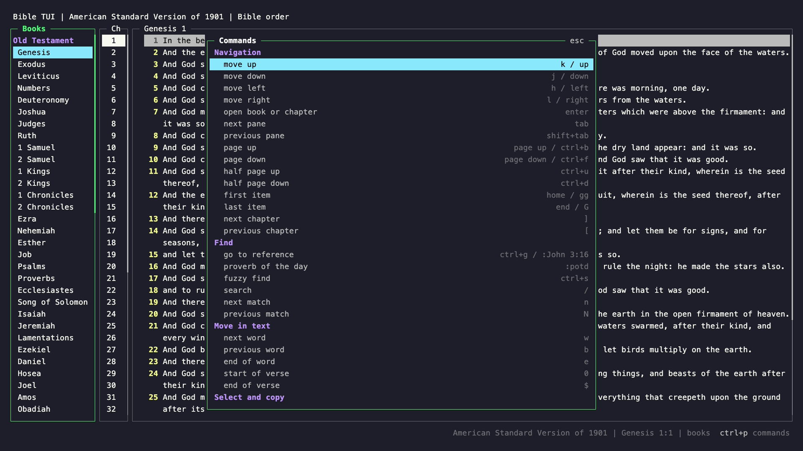
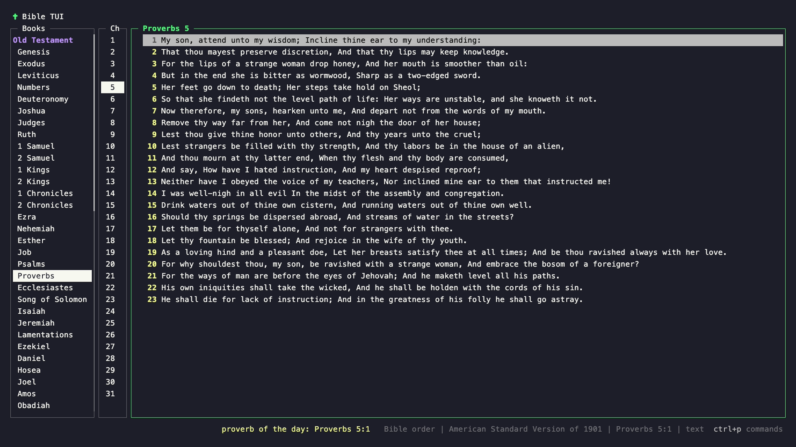
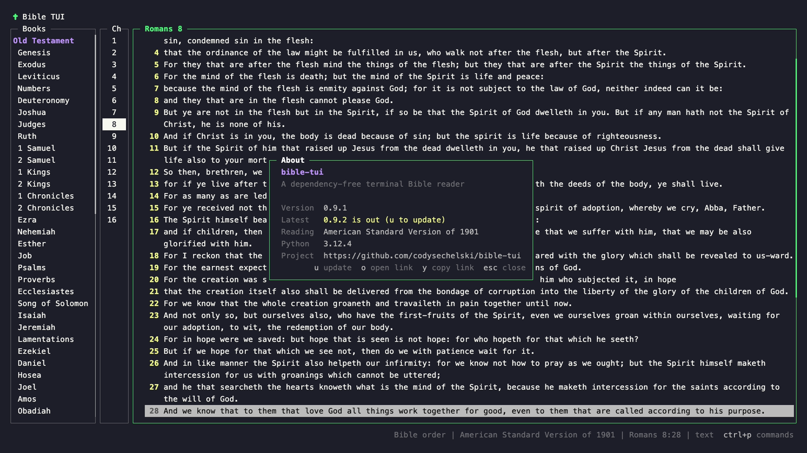
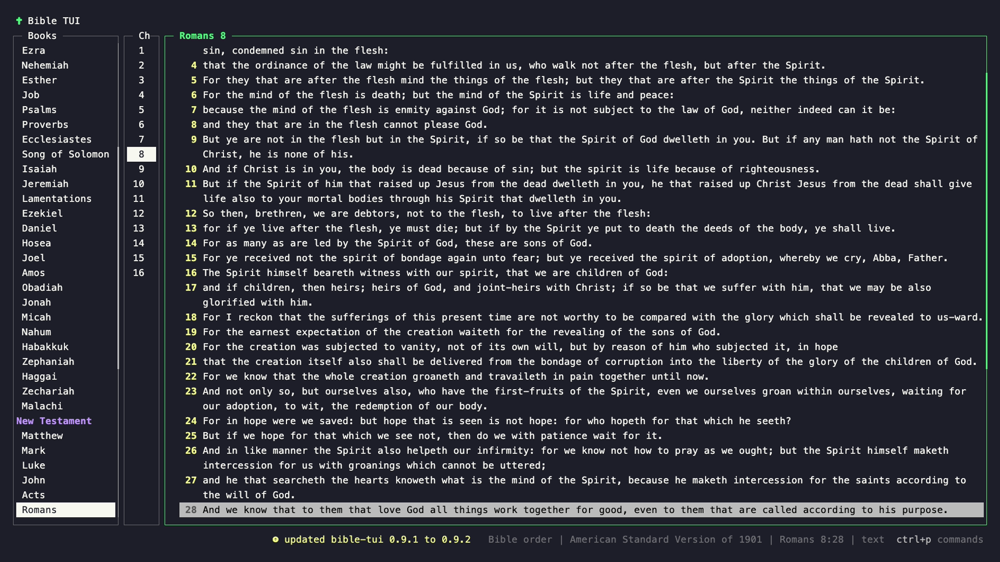

# Commands and the command line

You don't have to memorize anything: `ctrl+p` (or `?`) lists every action and its keys.

`:` opens a Vim-style command line in the footer, with a menu that suggests commands and references as you type.
Commands can be shortened like in Vim (`:q`, `:vs`).

| Command | Does |
| --- | --- |
| `:John 3:16`, `:John 3`, `:John` | [Go to](go-to-reference.md) a verse, chapter, or book |
| `:find [words]` | Open the [fuzzy finder](fuzzy-find.md) |
| `:set version=ASV` | Switch [version](versions.md) (`:set version` alone opens the picker) |
| `:vsplit` / `:split` | [Split](split-view.md) side by side / top and bottom |
| `:close` / `:only` | Close this pane / the other pane |
| `:marks` / `:highlights` | List [marks](marks.md) / [highlights](highlights.md) |
| `:potd` | Go to the proverb of the day: the chapter of Proverbs that matches today's date (Proverbs 28 on the 28th) |
| `:about` | Show the app version, update status, and project link |
| `:update` | Install a newer release and restart at the same verse |
| `:q` | Quit |

### Proverb of the day

`:potd` opens the chapter of Proverbs for today's date. It's also in the `ctrl+p` commands list.

### About and updates

When a newer release is out, the footer says so. `:about` shows the version you're running, the latest
release, and the project link (`o` opens it, `y` copies it, and `u` updates). `:update` installs the new release
and reopens the app at the same verse.

The full list is in [keybindings.md](../keybindings.md#the--command-line).
