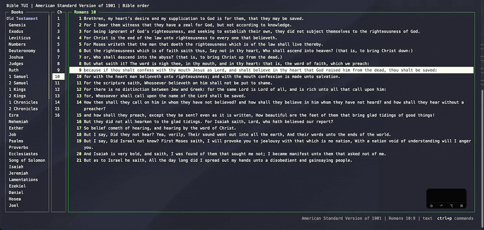
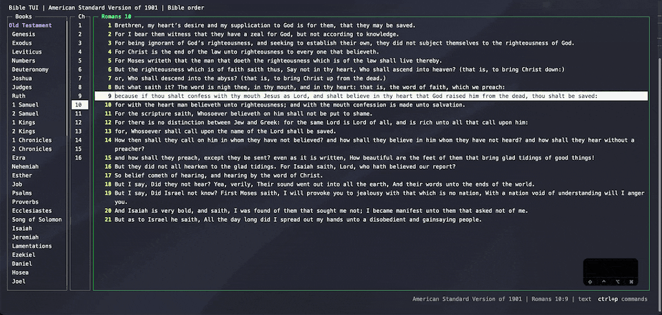

# Copying verses

`yy` copies the current verse. To copy part of a verse or several verses, select with `v` (characters) or `V`
(whole verses) and press `y`.



## Choose what `yy` copies

By default `yy` copies just the text. Set `yank_format` in `config.json` to add the reference, the version, or
anything else:

```json
{
  "yank_format": "{text}\n\n  ~ {reference} {version}"
}
```



The fields are `{text}`, `{reference}`, `{book}`, `{book_abbr}`, `{chapter}`, `{verse}`, `{version}`, and
`{version_name}`. See [the `yy` copy format](../configuration.md#the-yy-copy-format) for examples.

Copying uses the first of `pbcopy`, `wl-copy`, `xclip`, `xsel`, or `clip.exe` that is installed.
