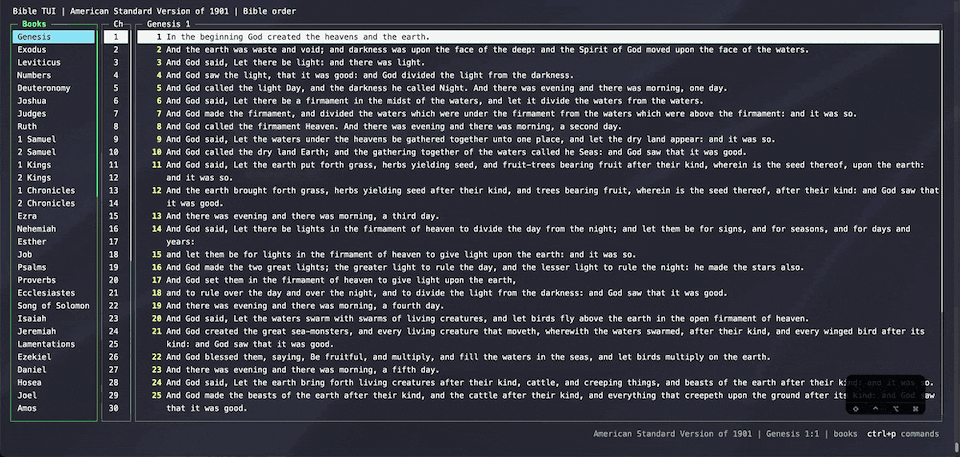

# Fuzzy-find the whole Bible

`ctrl+s` searches every verse in the current version as you type, with a preview of the selected verse. It's
built in, so there's nothing extra to install. Enter jumps to the verse.

Matching is loose by default, so typos and partial words still find what you meant. Press `ctrl+s` again inside
the finder to see the query syntax:

| Type | Example | Finds |
| --- | --- | --- |
| fuzzy | `lite` | a loose, typo-tolerant match (still finds "light") |
| exact | `'faith` | the exact text, also inside longer words ("faithful") |
| word | `'year'` | the whole word "year", but not "years" |
| prefix | `^blessed` | verses that begin with "blessed" |
| suffix | `wept.$` | verses that end with "wept." |
| exclude | `comfort !fear` | verses with "comfort" that don't mention "fear" |
| combine | `love neighbor` | verses containing both words |

You can also open it from the command line with `:find`, or `:find words` to start with a query.
