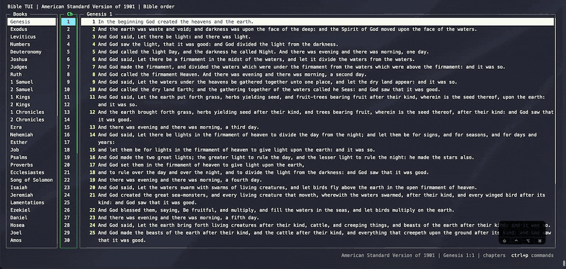

# Go to a reference

Type a reference like `John 3:16`, `John 3`, or just `John` and jump straight there. Book names autocomplete as
you type, then chapters, then verses.

There are two ways in:

- **`ctrl+g`** opens the Go To Reference box.
- **`:`** opens the Vim-style command line in the footer. `:John 3:16` goes to the verse, and the same line runs
  commands such as `:vsplit` or `:marks` (see [Commands and the command line](command-line.md)).

In both, Tab accepts the highlighted suggestion, `ctrl+n` or ↑ / ↓ move through the list, Enter goes, and Esc
cancels.
