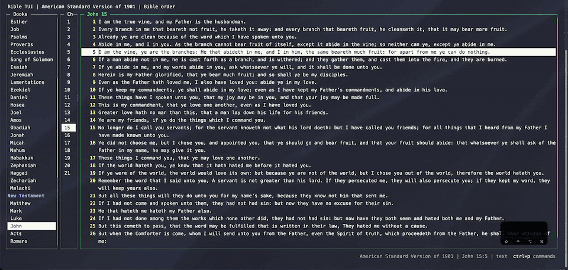
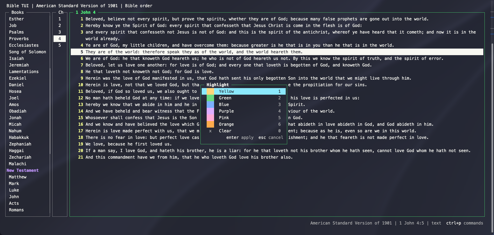
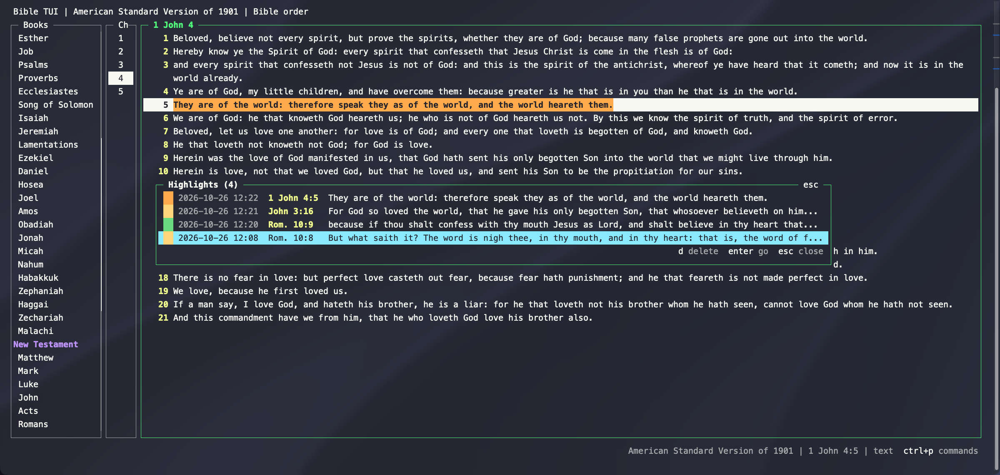

# Highlights

Press `c` to highlight the current verse, or every verse in a selection. Pick one of six colors with `1`–`6`
(or arrows and Enter), or clear the highlight with `0`.

`C` (or `"`) lists every highlight with its color, newest first. Enter jumps to one, and `d` or Delete removes
it.

Like [marks](marks.md), highlights are saved (to `highlights.json`) and show in every version.
