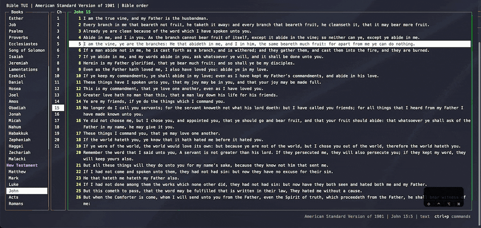
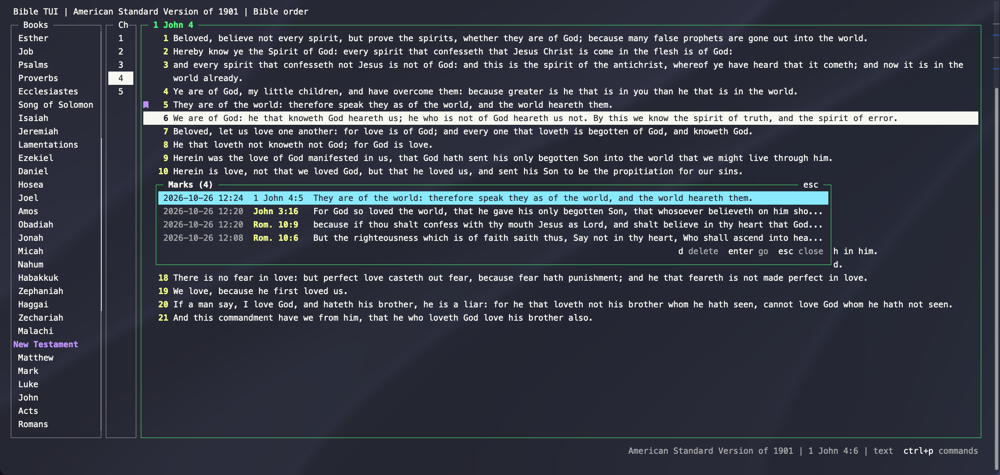

# Marks

Press `m` to mark a verse, like a bookmark. A sign appears next to the verse number. To mark several verses at
once, select them first with `V`. Press `m` again to unmark.

`M` (or `'`) lists every mark, newest first. Enter jumps to one, and `d` or Delete removes it.

Marks are saved to `marks.json`. They're stored by book, chapter, and verse, so they show in every version. The
sign is `●`, or a bookmark icon if you turn on `nerd_font` (see [configuration](../configuration.md)).
