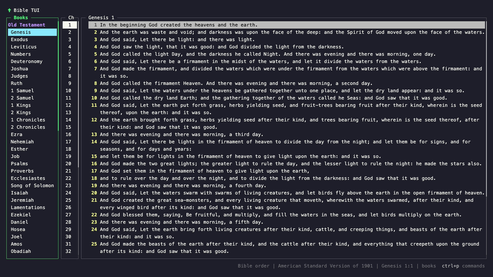
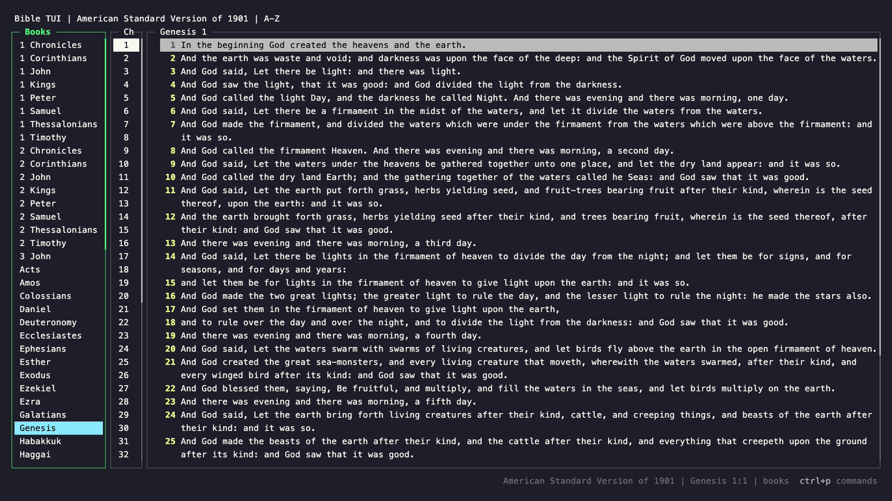

# Reading and navigation

The screen has three panes: books, chapters, and the text. Move through them with the arrow keys, Tab, Page
Up/Down, and Home/End, or use Vim keys if you know them. Highlighting a book shows its first chapter right away,
so you can browse without pressing Enter.

| Action | Keys | Vim-style |
| --- | --- | --- |
| Move up / down | ↑ / ↓ | `k` / `j` |
| Move between books, chapters, and text | ← / →, Tab / Shift+Tab | `h` / `l` |
| Half page up / down | | `ctrl+u` / `ctrl+d` |
| Page up / down | Page Up / Page Down | `ctrl+b` / `ctrl+f` |
| First / last item | Home / End | `gg` / `G` |
| Start / end of the verse | | `0` / `$` |
| Next word / previous word / end of word | | `w` / `b` / `e` |
| Bible order / alphabetical book list | `a` | |

## Chapter by chapter

`]` and `[` step to the next or previous chapter from anywhere. At the end of a book they continue into the
next one, in Bible order, even when the book list is sorted alphabetically.

## Book order

`a` switches the books pane between Bible order, grouped into the Old and New Testaments, and A to Z. The footer
shows which one you're in. `book_order` in [config.json](../configuration.md) sets the order it starts in.

| Bible order | A to Z |
| --- | --- |
|  |  |

Every key is listed in [keybindings.md](../keybindings.md), and in the app under `ctrl+p` or `?`.
