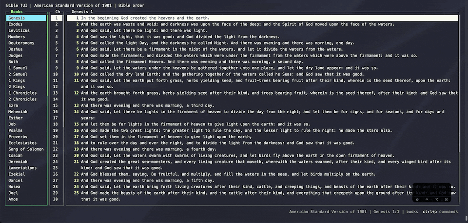

# Search books and chapters

`/` searches the pane you're in, Vim-style. In the books pane it finds book names. In the text pane it finds
words in the current chapter. Matches are highlighted as you type, with a count in the footer.

| Action | Keys |
| --- | --- |
| Start a search, or edit the current one | `/` |
| Accept the search | Enter |
| Next / previous match | `n` / `N` |
| Clear the highlighting | Esc |

After Enter, the footer keeps showing the search and which match you're on (`4 of 4`). Pressing `/` in the
chapters pane opens that chapter and searches its text.

To search the whole Bible at once, use the [fuzzy finder](fuzzy-find.md).
