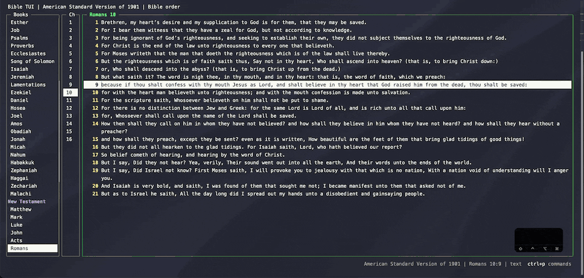

# Compare versions side by side

Split the text pane to read two versions at once, side by side or one above the other. Both panes follow the
same book and chapter, and each verse starts on the same line in both, so they're easy to compare. A verse that
one version leaves out is shaded.

The Portuguese text is the Bíblia Livre (BLIVRE), copyright © 2018 Diego Santos, Mario Sérgio, and Marco
Teles, from [eBible.org](https://ebible.org/porbr2018/copyright.htm), licensed under
[CC BY 4.0](https://creativecommons.org/licenses/by/4.0/). Not bundled with bible-tui.

| Action | Keys | Command |
| --- | --- | --- |
| Split side by side / top and bottom | `ctrl+w v` / `ctrl+w s` | `:vsplit` / `:split` |
| Move between the two panes | ← / →, Tab, or `ctrl+w w` | |
| Change either pane's version | `t` | `:set version=ASV` |
| Close this pane / the other pane | `ctrl+w q` / `ctrl+w o` | `:close` / `:only` |

Copying, `/` search, and the fuzzy finder use the pane you're in. Set `"remember_split": true` in `config.json`
to reopen the split next time.
