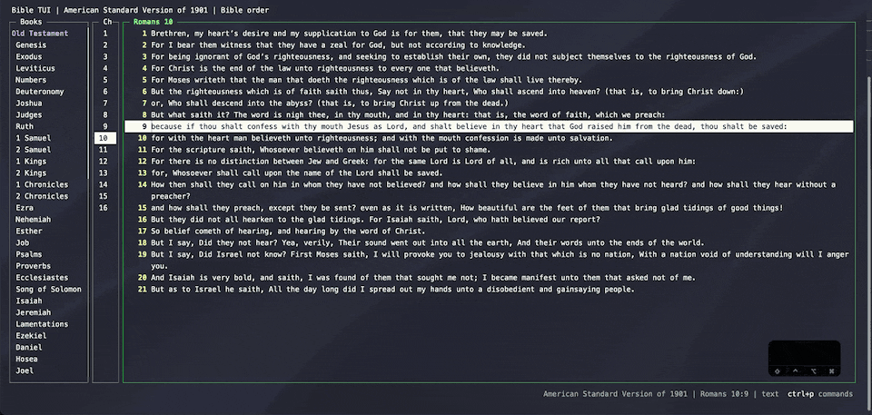
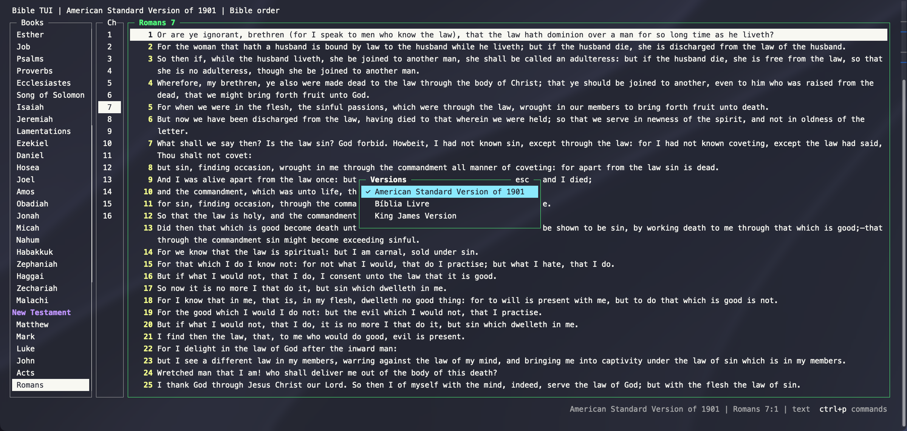
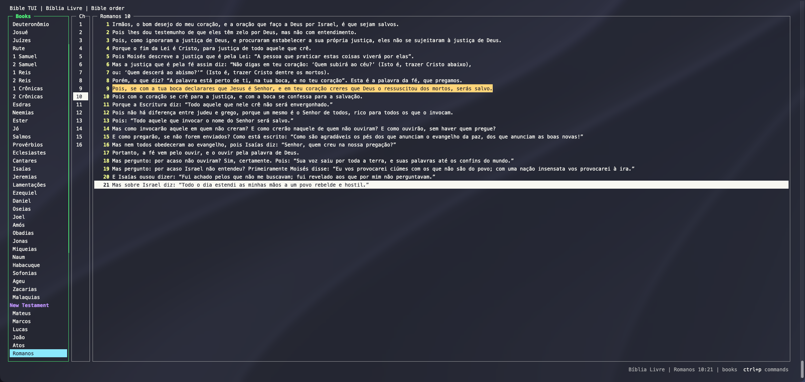

# Versions

bible-tui isn't tied to one translation. Each version is a single SQLite file, and every one it finds shows up
in the version picker. The public-domain KJV and ASV are included.

Press `t` to switch. You stay on the same verse, and your marks and highlights carry over.

## Any language

Book names and text come from the database, so a Bible in another language works just like the bundled ones.
This is the Portuguese Bíblia Livre:

Screenshot text: Bíblia Livre (BLIVRE), copyright © 2018 Diego Santos, Mario Sérgio, and Marco Teles, from
[eBible.org](https://ebible.org/porbr2018/copyright.htm), licensed under
[CC BY 4.0](https://creativecommons.org/licenses/by/4.0/). Not bundled with bible-tui.

## Adding more

Copy a database into `~/.config/bible-tui/bibles/` and it appears in the picker. To make one from a published
Bible (USFM, USX, OSIS, and others), see [adding-bibles.md](../adding-bibles.md).

Versions don't all have to cover the same verses. If you switch to one that leaves out the verse you're on,
bible-tui moves to the nearest verse before it.
