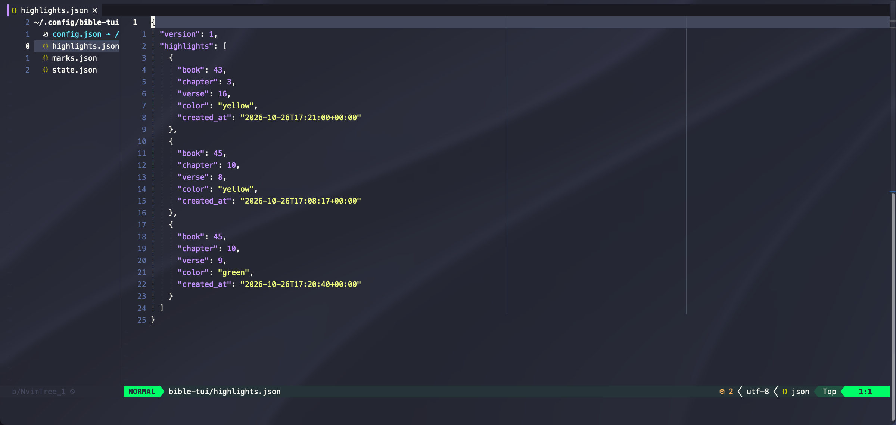
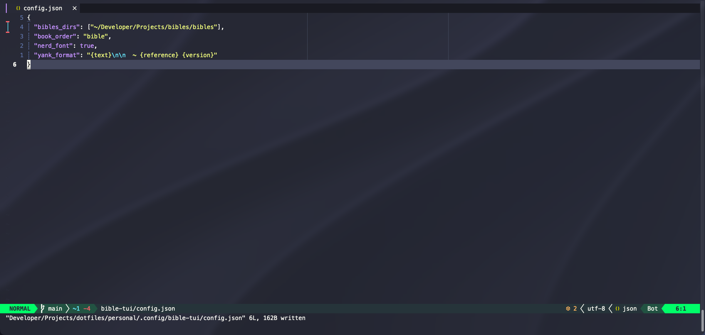

# Plain files you own

Everything bible-tui keeps is a readable JSON file in one folder, `~/.config/bible-tui` by default. Back it up,
sync it, or keep it in your dotfiles.

- **`config.json`** holds your settings. You write it and the app never rewrites it, so your formatting is kept
  and you can symlink it from a dotfiles repo.
- **`marks.json`** and **`highlights.json`** hold your marks and highlights, stored by book, chapter, and verse so
  they work in every version.
- **`state.json`** remembers small things, such as the last version you used.

Every setting is described in [configuration.md](../configuration.md).
